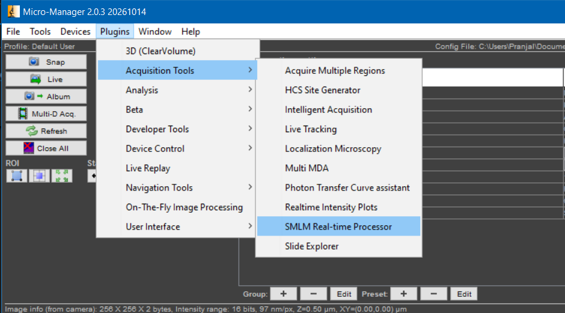
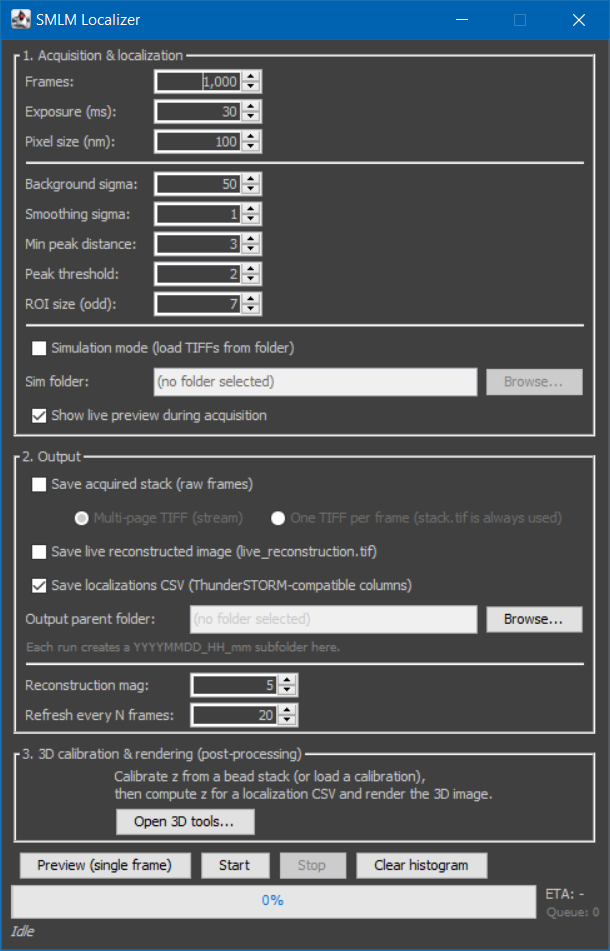
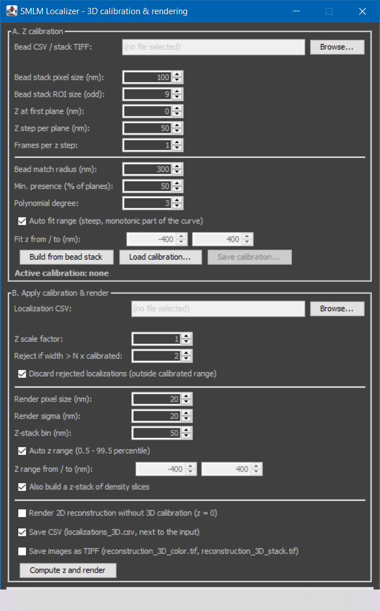

# MicroManagerSMLMLocalizer

**MicroManagerSMLMLocalizer** is a Micro-Manager 2.0 plugin for near-real-time single-molecule localization microscopy (SMLM) processing. It provides tools for live-image processing, localization, super-resolution reconstruction, data export, and post-processing.

## Features

- **Live preview and acquisition:** Detect point-spread functions (PSFs) and reconstruct super-resolved images from accumulated localizations.
- **Flexible image saving:** Save individual frame TIFF files or a plain multipage TIFF stack compatible with ImageJ.
- **Localization export:** Export detected localizations to CSV files containing frame number, amplitude, and coordinates.
- **Simulation mode:** Process TIFF images from a folder as if they were acquired sequentially from a camera.
- **Post-processing and calibration:** Process localization data and perform calibration using bead-stack TIFF images or localization CSV files to reconstruct the 3D structure.

---

## Table of Contents

- [Requirements](#requirements)
- [Build and Install](#build-and-install-netbeans--ant)
- [Usage](#usage)
- [Post-Processing and Z-Calibration](#post-processing-and-z-calibration)
- [Configuration Notes and Troubleshooting](#configuration-notes-and-troubleshooting)
- [Contributing](#contributing)
- [License](#license)
- [Author](#author)

---

## Requirements

- **Micro-Manager 2.0:** Tested with Micro-Manager 2.0 stable and 2.0.3 nightly builds as of 23 October 2026.
- **Java 8:** Use a JDK compatible with your Micro-Manager installation.
- **NetBeans and Apache Ant:** The provided project uses NetBeans with Ant. Other IDEs may also be used.
- **Additional dependencies:** Place the required JAR files in the appropriate Micro-Manager plugin or library directory, as applicable to your installation:
  - [JTransforms 3.1](https://mvnrepository.com/artifact/com.github.wendykierp/JTransforms/3.1) — `JTransforms-3.*.jar`
  - [JLargeArrays 1.5](https://mvnrepository.com/artifact/pl.edu.icm/JLargeArrays/1.5) — `JLargeArrays-1.*.jar`

> **Note:** The plugin uses SciJava annotations. Ensure annotation processing is enabled in your NetBeans/Ant build so that the plugin metadata is generated correctly.

---

## Build and Install (NetBeans + Ant)

### 1. Set up the project

1. Clone the repository containing the NetBeans and Ant project.
2. Open the project in NetBeans.
3. If the project cannot be opened directly, create or configure a Java project using Ant and follow the [Micro-Manager NetBeans development instructions](https://micro-manager.org/Using_Netbeans).
4. Ensure annotation processing is enabled under **Project Properties → Annotation Processors**.
5. Clean and build the project.

### 2. Install the plugin

1. Copy `dist/SMLMLocalizer.jar` into the appropriate Micro-Manager plugin directory, typically `mmplugins`.
2. Ensure that the required dependency JARs are accessible to Micro-Manager and are not already supplied by your installation.
3. Restart Micro-Manager.
4. Open the plugin from the menu registered by its SciJava metadata. The menu entry may appear as **Plugins → Acquisition Tools → SMLM Real-time Processor**, depending on the build configuration.

---

## Usage

### 1. Start the plugin

1. Start Micro-Manager and connect to your camera.
2. Open the camera's live view if you intend to process live images.
3. Optionally, configure the camera ROI through the main Micro-Manager interface. The plugin processes images using the dimensions of the frames it receives.
4. Open the plugin from the Micro-Manager menu.

### 2. Configure processing parameters

Configure the parameters available in the plugin interface. These may include:

- Number of frames and exposure time
- Magnification and update interval
- Background estimation and smoothing
- Minimum peak distance and detection threshold
- Localization ROI size
- Other acquisition and processing settings exposed by the interface

### 3. Select the image source and saving mode

Choose the appropriate image source and output settings.

The available saving options include:

- **Save as multipage TIFF:** Save acquired frames as a plain TIFF stack compatible with ImageJ. The stack is written at the end of the acquisition and does not include OME metadata.
- **Save per-frame TIFF files:** Save frames as individual TIFF images.

For simulation, select a folder containing TIFF images to process them sequentially as simulated camera frames.

### 4. Preview and acquire

1. Click **Preview** to test processing on a single frame from the selected source.
2. Click **Start** to begin acquisition and processing.
3. Monitor acquisition progress and the estimated time remaining, where displayed.
4. After processing, inspect the reconstructed super-resolution image and exported localization data in the output directory.

The localization CSV contains the columns:

`Frame, Amplitude, X, Y`

The exact output files depend on the selected acquisition, saving, and post-processing options.

---

## Post-Processing and Z-Calibration

The plugin provides post-processing functionality for localization data and bead-stack-based calibration.

### 1. Open the post-processing interface

Open the post-processing interface and select the appropriate input data for the intended operation.

### 2. Configure the bead-stack ROI size

When localizing bead-stack TIFF images for Z-calibration, configure the **Bead stack ROI size** parameter.

- **Default:** 9 pixels
- **Allowed range:** 3–31 pixels
- **Increment:** 2 pixels
- **Requirement:** Use an odd-numbered ROI size

The ROI size determines the image region used for bead localization during calibration. It is configurable rather than fixed at 9 pixels.

**[Screenshot placeholder: Bead-stack ROI size control]**

### 3. Perform calibration

1. Select the bead-stack TIFF data or the relevant localization CSV file.
2. Set the appropriate pixel-size and calibration parameters.
3. For bead-stack TIFF input, choose the desired odd-numbered ROI size.
4. Run the localization and calibration procedure.
5. Inspect the generated calibration results and any warnings reported by the plugin.

When using localization CSV data, the calibration procedure can use available acquisition metadata for the ROI size. If such metadata is unavailable, the configured ROI size may be used as a fallback.

**Important:** Use a consistent ROI size between bead-stack calibration and the experimental localization workflow whenever the calibration method requires matching ROI settings. Check any ROI-mismatch warnings before relying on the calibration results.

---

## Configuration Notes and Troubleshooting

### ROI handling

The camera ROI selected in Micro-Manager determines the dimensions of the frames received by the plugin. This is distinct from the localization ROI used to analyse an individual PSF and the bead-stack ROI used during calibration.

Do not assume these three ROI settings are interchangeable.

### Bead-stack ROI size

The bead-stack ROI control accepts odd-numbered sizes from 3 to 31 pixels. If calibration results appear inconsistent, verify the selected ROI size and check whether the calibration and experimental localization settings are compatible.

### Multipage TIFF memory usage

The multipage TIFF mode collects frames in an image stack and writes the TIFF at the end of acquisition. Large acquisitions may require substantial memory. Consider saving individual frame TIFFs if memory becomes a limitation.

### TIFF metadata

The multipage TIFF output is a plain TIFF stack and does not include OME metadata. Additional metadata-writing support would require a suitable metadata-aware writer and configuration.

### Saving failures

If saving fails:

- Check that the output directory exists and is writable.
- Confirm that sufficient disk space is available.
- Check the Micro-Manager log for relevant error messages.

### CSV format

The localization CSV contains:

`Frame, Amplitude, X, Y`

Check the output file and the settings used for localization before interpreting the coordinate values or comparing data from different acquisitions.

---

## Contributing

- Open an issue to report bugs or request features.
- Pull requests are welcome. Keep changes focused and document any new external dependencies.
- Include tests where feasible and aim to preserve backward compatibility when modifying existing functionality.

---

## License

This repository is released under the **BSD 3-Clause License**. See [LICENSE](./LICENSE) for details.

---

## Author

**Pranjal Choudhury**  
MicroManagerSMLMLocalizer — 2026
